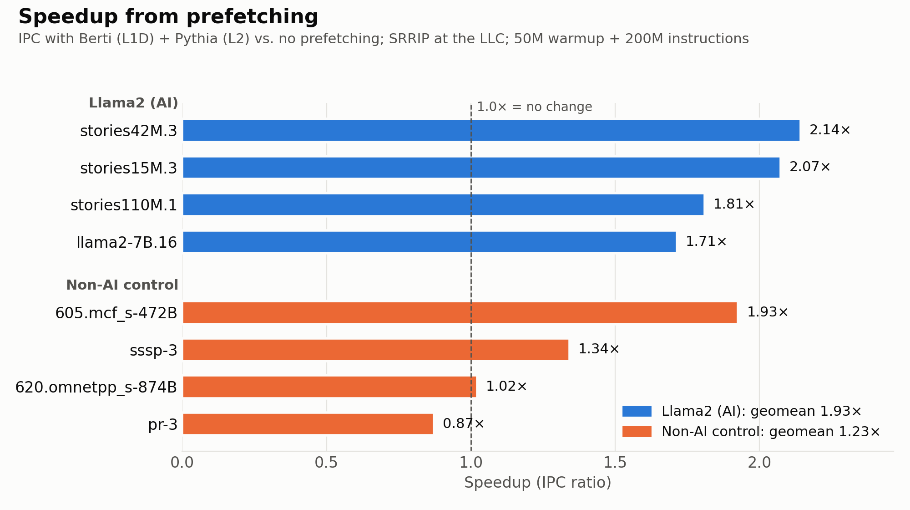
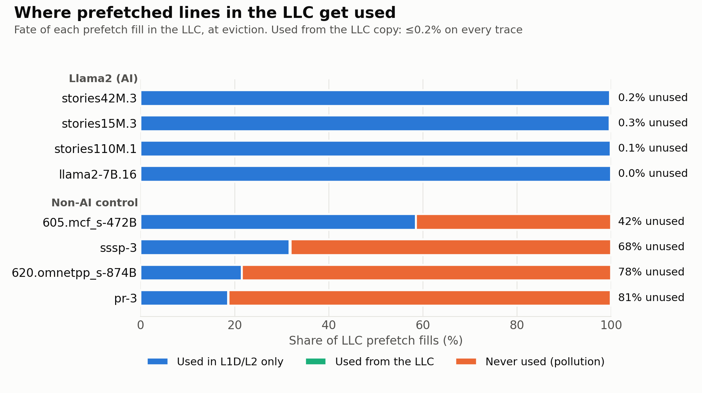
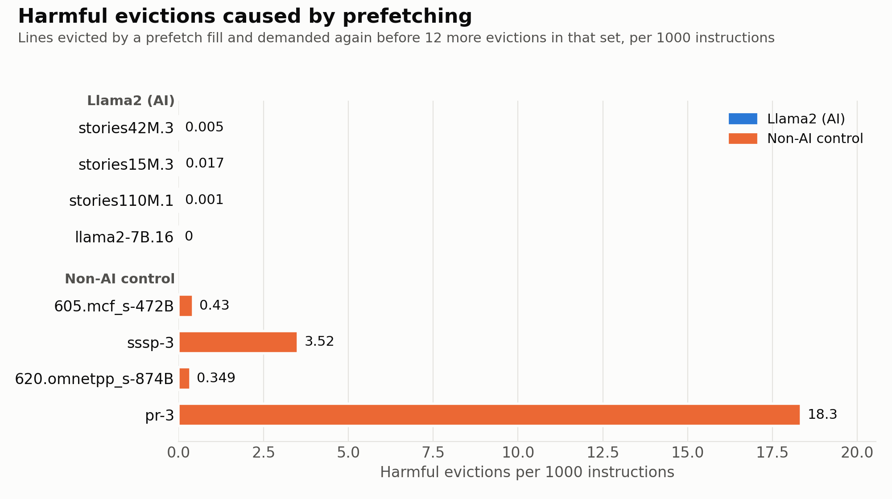

# Prefetch-Aware LLC Insertion Under Aggressive Prefetching

CS683 (Advanced Computer Architecture) course project, IIT Bombay.
Hrishikesh Bingewar (24b3983@iitb.ac.in). Bin 1: Simulator.

This repository is a fork of the [DPC4 ChampSim](https://github.com/CMU-SAFARI/ChampSim) simulator used in the Fourth Data Prefetching Championship (DPC4, HPCA 2026). The original ChampSim README is kept in [README_ChampSim.md](README_ChampSim.md).

**Status:** Checkpoint 1 is complete. Checkpoint 2 (insertion policies) is next.

## Research question

Prefetched lines that are never used still occupy last-level cache (LLC) space and can evict lines that the program reuses. Prefetch-aware insertion policies such as PACMan (Prefetch-Aware Cache Management) and SHiP++ (Signature-based Hit Predictor) insert prefetches at low priority, but they were designed with older prefetchers and evaluated on SPEC CPU benchmarks.

DPC4 uses aggressive prefetchers (Berti at the L1 data cache, Pythia at L2), and most useful prefetches may be consumed before the LLC. This project asks:

> Do prefetch-aware LLC insertion policies still pay off under the DPC4 prefetchers, and what explains the differences between them?

The project evaluates this on DPC4 Llama2 (AI) traces and on non-AI control traces.

## Checkpoint 1: what is done

| Plan item | Status | Where |
|---|---|---|
| Build and validate DPC4 ChampSim | Done | [results/golden/](results/golden/) |
| Screen traces; pick 4 Llama2 + 4 control traces | Done | [results/screening.csv](results/screening.csv), [scripts/final_traces.txt](scripts/final_traces.txt) |
| Carry the triggering PC to the LLC | Done | [inc/channel.h](inc/channel.h), [inc/cache.h](inc/cache.h), [src/cache.cc](src/cache.cc) |
| Add prefetch-reuse and harmful-eviction counters | Done | [inc/pf_study.h](inc/pf_study.h), [src/pf_study.cc](src/pf_study.cc) |
| Run all 8 traces with and without prefetching (SRRIP at the LLC) | Done | [results/final_checkpoint1.csv](results/final_checkpoint1.csv), [results/plots/](results/plots/) |

### 1. Simulator configuration

Two single-core configurations derive from the DPC4 full-bandwidth baseline. The only change from the baseline is the LLC replacement policy: SRRIP (Static Re-Reference Interval Prediction) instead of DRRIP.

| Config | L1D prefetcher | L2 prefetcher | LLC replacement |
|---|---|---|---|
| [dpc4/1C.fullBW.srrip.json](dpc4/1C.fullBW.srrip.json) | Berti | Pythia | SRRIP |
| [dpc4/1C.fullBW.srrip_nopref.json](dpc4/1C.fullBW.srrip_nopref.json) | none | none | SRRIP |

| Component | Parameters |
|---|---|
| Core | 4 GHz, 8-wide, 576-entry reorder buffer |
| L1D | 48 KB, 12-way |
| L2 | 2 MB, 16-way |
| LLC | 3 MB, 12-way, no LLC prefetcher |
| DRAM | DDR5-4800, one channel |

### 2. Validation

The simulator is deterministic. [results/golden/](results/golden/) holds the output of the unmodified simulator for both configurations (Llama2 7B trace 1, 1M warmup + 10M simulated instructions). After every code change, both configurations are rerun and diffed against these files, ignoring wall-clock time and the new `PFSTUDY` lines. The final code produces identical output, so the new counters only observe the simulation and never change it.

### 3. Carrying the prefetch PC to the LLC

Requests already carry an `ip` field down to the LLC, but it is empty for prefetches. Filling it in changes what Pythia learns from, because Pythia trains on the `ip` of every request it sees, including L1D prefetches. So the change adds a separate field that nothing in the simulator reads:

- `pf_ip` in `request` ([inc/channel.h](inc/channel.h)) and in `tag_lookup_type` and `mshr_type` ([inc/cache.h](inc/cache.h)), copied when a request moves to the next level.
- `CACHE::pf_trigger_ip` records the PC of the access that is training the prefetcher. `prefetch_line` stamps it on every new prefetch. For a prefetch triggered by another prefetch (for example, Pythia reacting to a Berti prefetch at L2), the original load PC carries through.

Berti and Pythia need no changes.

### 4. Prefetch-fate and harmful-eviction counters

[src/pf_study.cc](src/pf_study.cc) tracks every prefetch fill into the LLC and classifies it when it is evicted:

- **Used from the LLC:** a demand access hits the LLC copy.
- **Used in L1D or L2 only:** a demand access hits the line in L1D or L2 while the LLC copy exists, or merges into the in-flight prefetch (a late prefetch). The LLC copy itself is never used.
- **Never used:** no demand access reaches the line.

A **harmful eviction** is a line that a prefetch fill evicts from the LLC and that a demand access requests again before 12 more evictions in that set (the LLC associativity). In other words, it would likely still be in the cache without that prefetch. Each LLC set keeps a 12-entry list of recent victims to detect this.

Counters reset at the end of warmup. Totals and the top 20 triggering PCs print at the end of each run as `PFSTUDY` lines. The counters assume a single core.

### 5. Trace selection

[scripts/run_screen.sh](scripts/run_screen.sh) runs 43 DPC4 candidate traces (all 25 Llama2 traces, plus 18 SPEC CPU 2017 and GAP graph traces) with and without prefetching, for 10M warmup + 50M simulated instructions. [results/screening.csv](results/screening.csv) has the results.

The final 8 traces cover a range of prefetching speedups:

| Group | Traces |
|---|---|
| Llama2 (AI) | stories42M.3, stories15M.3, stories110M.1, llama2_7b.16 (one per model size) |
| Control | 605.mcf_s-472B, sssp-3 (GAP), 620.omnetpp_s-874B, pr-3 (GAP) |

The controls all have significant LLC traffic and real LLC reuse, ranging from "prefetching helps a lot" (mcf) to "prefetching hurts" (pr-3).

### 6. Results

All final runs use the DPC4 settings: 50M warmup + 200M simulated instructions. Speedup is IPC (instructions per cycle) with prefetching divided by IPC without. MPKI is misses per kilo-instruction and PKI is per kilo-instruction.

| Trace | Speedup | LLC load MPKI (pref / no pref) | Fills never used | Harmful evictions PKI |
|---|---|---|---|---|
| stories42M.3 | 2.14 | 2.34 / 33.99 | 0.2% | 0.005 |
| stories15M.3 | 2.07 | 2.58 / 31.43 | 0.3% | 0.017 |
| stories110M.1 | 1.81 | 3.89 / 34.76 | 0.1% | 0.001 |
| llama2_7b.16 | 1.71 | 4.21 / 35.56 | 0.0% | 0.000 |
| 605.mcf_s-472B | 1.93 | 6.66 / 26.95 | 41.5% | 0.43 |
| sssp-3 | 1.34 | 5.66 / 10.24 | 68.1% | 3.52 |
| 620.omnetpp_s-874B | 1.02 | 4.63 / 6.99 | 78.5% | 0.35 |
| pr-3 | 0.87 | 35.47 / 45.29 | 81.2% | 18.35 |

The geometric-mean speedup is **1.93×** for Llama2 and **1.23×** for the controls. [results/final_checkpoint1.csv](results/final_checkpoint1.csv) also has prefetch accuracy and coverage.





### Findings

1. **The LLC copy of a prefetch almost never serves a demand.** On every trace, at most 0.2% of LLC prefetch fills are used from the LLC. When a prefetched line is used, the L1D or L2 copy serves it.
2. **Llama2 shows almost no LLC pollution.** 99.7% or more of fills are used in L1D or L2, and harmful evictions are near zero. The traces stream model weights with no LLC reuse to protect.
3. **The controls show real pollution.** 42% to 81% of fills are never used. pr-3 has 18.3 harmful evictions PKI and slows down to 0.87×. Its 104 prefetch fills PKI also compete for DRAM bandwidth, so pollution is not the only cause of the slowdown.
4. **Hypothesis for Checkpoint 2:** inserting all prefetches at low priority (PACMan-style) should cost almost nothing on Llama2 and help polluting traces such as pr-3 and sssp. Per-PC predictors only beat it where some PCs' prefetches are reused in the LLC, and Checkpoint 1 finds very little such reuse.

## Reproducing the results

### Setup (macOS or Linux)

```bash
git submodule update --init
vcpkg/bootstrap-vcpkg.sh
vcpkg/vcpkg install
```

Build both binaries. `config.sh` keeps only the last configuration, so build them one after the other:

```bash
./config.sh dpc4/1C.fullBW.srrip_nopref.json && make -j && ./config.sh dpc4/1C.fullBW.srrip.json && make -j
```

### Traces

The DPC4 traces are at `https://traces.rbera.com/dpc4/` (index: `manifest.txt`). Put them in `traces/`, which git ignores. For example:

```bash
grep -v '^#' scripts/screen_traces.txt | while read p; do curl -C - -o "traces/$(basename $p)" "https://traces.rbera.com/dpc4/$p"; done
```

### Validate

```bash
bin/1C.fullBW.srrip --warmup-instructions 1000000 --simulation-instructions 10000000 traces/llama2.c-llama2_7b.1.champsimtrace.gz > results/raw/v_srrip.txt
diff <(grep -iv -e time -e PFSTUDY results/golden/srrip_llama7b1.txt) <(grep -iv -e time -e PFSTUDY results/raw/v_srrip.txt) && echo IDENTICAL
```

### Run and plot

```bash
scripts/run_screen.sh 10000000 50000000 6   # optional: trace screening
python3 scripts/parse_screen.py

scripts/run_final.sh 8                      # 16 runs at DPC4 lengths
python3 scripts/parse_final.py              # writes results/final_checkpoint1.csv
python3 scripts/plot_checkpoint1.py         # writes results/plots/
```

Raw simulator output goes to `results/raw/`, which git ignores. On a laptop running 8 jobs in parallel, the final runs take about 2–3 hours. pr-3 is the slowest, so it starts first.

## Next: Checkpoint 2

- Implement PACMan-style insertion and a separate-table predictor; port SHiP++ from the Second Cache Replacement Championship (CRC2).
- Run 8 traces × 5 policies (SRRIP, PACMan-style, SHiP, SHiP++, separate table) with identical settings.
- Report the per-group geometric-mean IPC speedup, LLC MPKI, harmful evictions and storage cost, and test the hypothesis above using the per-PC counters.

## References

- N. Gober et al., *The Championship Simulator: Architectural Simulation for Education and Competition*, 2022.
- DPC4: [CMU-SAFARI/DPC4](https://github.com/CMU-SAFARI/DPC4) (HPCA 2026).
- A. Jaleel et al., *High Performance Cache Replacement Using Re-Reference Interval Prediction (RRIP)*, ISCA 2010.
- C.-J. Wu et al., *PACMan: Prefetch-Aware Cache Management for High Performance Caching*, MICRO 2011.
- C.-J. Wu et al., *SHiP: Signature-based Hit Predictor for High Performance Caching*, MICRO 2011.
- V. Young et al., *SHiP++: Enhancing Signature-Based Hit Predictor for Improved Cache Performance*, CRC2 2017.
